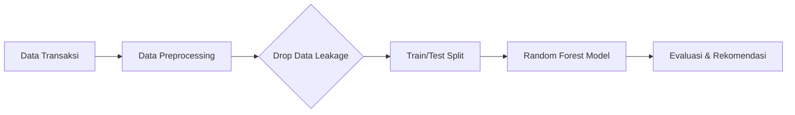
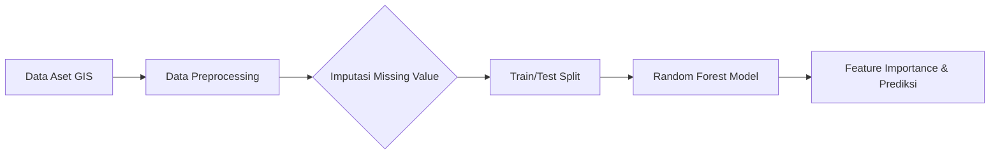

Gemini

Percakapan baru
Koleksi
Gambar
Dijadwalkan
Pelajar

Selengkapnya
Notebook baru
Rangkuman Transkrip Video Pembelajaran
Rangkuman Transkrip Video Informatika
Rangkuman Transkrip Materi IMK
Kuliah Tamu Analisis Data dan AI
Rangkuman Materi Machine Learning
Ringkasan Global Infrastructure HPC
Cara Cek Gamut Warna Laptop
Sapaan dan Tawaran Bantuan
Topik Skripsi Pengolahan Citra Digital
Meminta Pendapat Visual Foto
Ilustrasi Brody dan Yi Sun-shin
Menentukan Nomor Host Alamat IP
Memahami Rumus Turunan Numerik
Pertimbangan Implementasi Serat Optik
Organisasi Standar Jaringan dan Akronim
Tujuan Lapisan Fisik OSI
Oracle APEX Workspace: Definisi dan Penjelasan
Deskripsi Accept Page APEX
Persyaratan Kata Sandi Oracle
Makna Argumen Posisional Python
Otak Anak Usia Dini Gunakan Energi
Asal Usul Python: Proyek Hobi
Percakapan dengan Gemini
error pada saat ingin pust git file ini di folder ini


PS C:\laragon\www\informatic practitioner lectur> git add City_Care_Property.py

PS C:\laragon\www\informatic practitioner lectur> git commit -m "City_Care_Property.py"

[main 6a6abbd] City_Care_Property.py

 1 file changed, 56 insertions(+)

 create mode 100644 City_Care_Property.py

PS C:\laragon\www\informatic practitioner lectur> git push origin main

To https://github.com/Muhammadripalrbb/prediksi-kualitas-udara-pm25.git

 ! [rejected]        main -> main (fetch first)

error: failed to push some refs to 'https://github.com/Muhammadripalrbb/prediksi-kualitas-udara-pm25.git'

hint: Updates were rejected because the remote contains work that you do not

hint: have locally. This is usually caused by another repository pushing to

hint: the same ref. If you want to integrate the remote changes, use

hint: 'git pull' before pushing again.

hint: See the 'Note about fast-forwards' in 'git push --help' for details.

Error ! [rejected] main -> main (fetch first) terjadi karena repositori GitHub (remote) memiliki file atau commit baru (misalnya file README.md, .gitignore, atau perubahan dari perangkat lain) yang belum ada di komputer lokalmu. Git menolak push untuk mencegah file di GitHub tertimpa secara tidak sengaja.

Berikut dua cara utama untuk mengatasinya:

Solusi 1: Gabungkan perubahan dari GitHub terlebih dahulu (Sangat Direkomendasikan)
Ambil perubahan terbaru dari GitHub dan gabungkan dengan komit lokalmu, baru lakukan push:

Jalankan perintah pull dengan rebase:

PowerShell
git pull origin main --rebase
(Jika muncul error refusing to merge unrelated histories karena repositori baru saja diinisialisasi di GitHub dengan file README, gunakan perintah: git pull origin main --allow-unrelated-histories)

Lakukan push ulang ke GitHub:

PowerShell
git push origin main
Solusi 2: Paksa Push / Force Push (Gunakan HANYA jika file di GitHub tidak penting)
Jika repositori di GitHub baru saja dibuat dan kamu ingin menimpa/menghapus seluruh isi repositori GitHub dengan file lokalmu:

PowerShell
git push origin main --force
Peringatan: Cara --force akan menghapus semua file/histori yang ada di GitHub yang belum sempat di-download ke komputer lokalmu. Gunakan cara ini hanya jika kamu yakin isi di GitHub saat ini tidak dibutuhkan.

berikan kode push git ketika hanya ingin push 1 file saja yang dimana isi dalam folder itu ada beberapa file .py lain yang sudah di push

Urutan perintah Git untuk melakukan push pada 1 file spesifik saja tanpa membawa perubahan file .py lainnya:

Bash
# 1. Masukkan HANYA 1 file yang ingin di-push ke staging area
git add nama_file.py

# 2. (Opsional) Pastikan hanya file tersebut yang berwarna hijau (staged)
git status

# 3. Buat commit khusus untuk file tersebut
git commit -m "Update file nama_file.py"

# 4. Push ke repositori remote
git push origin main
Contoh Kasus Spesifik:

PowerShell
git add City_Care_Property.py
git commit -m "Menambahkan script City Care Property"
git push origin main
Catatan Penting:

Avoid git add . or git add -A because those commands stage all modified and untracked files in the current directory.

File .py lain yang berada di folder yang sama akan tetap berada di komputer lokal kamu (berstatus unstaged atau untracked) dan tidak akan terikut ke GitHub.

PS C:\laragon\www\informatic practitioner lectur> git add City_Care_Property.py

>> git commit -m "Menambahkan script City Care Property"

>> git push origin main

On branch main

Your branch is ahead of 'origin/main' by 1 commit.

  (use "git push" to publish your local commits)


Changes not staged for commit:

  (use "git add/rm <file>..." to update what will be committed)

  (use "git restore <file>..." to discard changes in working directory)

        deleted:    sesi2.py


no changes added to commit (use "git add" and/or "git commit -a")

To https://github.com/Muhammadripalrbb/prediksi-kualitas-udara-pm25.git

 ! [rejected]        main -> main (fetch first)

error: failed to push some refs to 'https://github.com/Muhammadripalrbb/prediksi-kualitas-udara-pm25.git'

hint: Updates were rejected because the remote contains work that you do not

hint: have locally. This is usually caused by another repository pushing to

hint: the same ref. If you want to integrate the remote changes, use

hint: 'git pull' before pushing again.

hint: See the 'Note about fast-forwards' in 'git push --help' for details.

PS C:\laragon\www\informatic practitioner lectur> 

Error yang muncul saat ini masih sama dengan sebelumnya, yaitu ! [rejected] main -> main (fetch first). Ini berarti di repositori GitHub kamu masih ada file/perubahan yang belum ada di laptop kamu.

Selain itu, jika kamu perhatikan pesan ini:

Your branch is ahead of 'origin/main' by 1 commit.

no changes added to commit

Itu artinya file City_Care_Property.py kamu sebenarnya sudah berhasil di-commit (disimpan di Git lokal) pada percobaanmu yang sebelumnya. Jadi kamu tidak perlu melakukan git add dan git commit lagi.

Untuk menyelesaikan masalah push ini, kamu wajib melakukan pull (menarik data dari GitHub) terlebih dahulu agar sinkron. Jalankan urutan perintah berikut:

Langkah 1: Tarik perubahan dari GitHub ke laptopmu

PowerShell
git pull origin main --rebase
(Catatan: Jika muncul error berbunyi fatal: refusing to merge unrelated histories, ganti perintahnya menjadi: git pull origin main --rebase --allow-unrelated-histories)

Langkah 2: Push kembali ke GitHub
Setelah langkah pertama berhasil dan tidak ada error, dorong kembali file tersebut ke GitHub:

PowerShell
git push origin main
Kenapa muncul tulisan deleted: sesi2.py?
Itu hanya informasi dari Git bahwa kamu telah menghapus file sesi2.py di folder laptopmu, namun penghapusan tersebut belum kamu konfirmasi (commit) ke dalam Git. Karena kamu hanya ingin melakukan push file City_Care_Property.py, kamu bisa mengabaikan pesan sesi2.py tersebut.

PS C:\laragon\www\informatic practitioner lectur> git push origin main

To https://github.com/Muhammadripalrbb/prediksi-kualitas-udara-pm25.git

 ! [rejected]        main -> main (fetch first)

error: failed to push some refs to 'https://github.com/Muhammadripalrbb/prediksi-kualitas-udara-pm25.git'

hint: Updates were rejected because the remote contains work that you do not

hint: have locally. This is usually caused by another repository pushing to

hint: the same ref. If you want to integrate the remote changes, use

hint: 'git pull' before pushing again.

hint: See the 'Note about fast-forwards' in 'git push --help' for details.

PS C:\laragon\www\informatic practitioner lectur> 


kenapa ada prediksi kualitas udara dsini? apa ga bisa ya push 1 file di dalam folder ny tu ada beberapa file lain? apa harus buat folder baru lgi

Pertanyaan yang sangat bagus. Mari kita bedah kebingungan ini satu per satu.

1. Kenapa muncul "prediksi-kualitas-udara-pm25"?
Ini terjadi karena folder lokal komputermu (informatic practitioner lectur) saat ini terhubung (terkoneksi) ke repositori GitHub bernama prediksi-kualitas-udara-pm25. Di dalam Git, koneksi ini disebut sebagai remote origin.

Git tidak peduli apa nama folder di komputermu; ia hanya akan mengirim file ke URL remote yang sudah disetting sebelumnya. Kemungkinan besar, kamu sebelumnya pernah melakukan perintah git remote add origin [https://github.com/.../prediksi-kualitas-udara-pm25.git](https://github.com/.../prediksi-kualitas-udara-pm25.git) di dalam folder ini (atau folder induknya seperti folder www).

2. Apakah bisa push hanya 1 file di dalam folder yang banyak file lain?
BISA BANGET. Error [rejected] (fetch first) yang kamu alami BUKAN karena ada file lain di dalam folder tersebut. Kamu TIDAK PERLU membuat folder baru.

Error itu murni terjadi karena repositori prediksi-kualitas-udara-pm25 di GitHub memiliki file atau riwayat perubahan (misalnya file README atau script prediksi udara) yang tidak ada di dalam komputermu saat ini. Git memblokir proses push agar kamu tidak menimpa file yang sudah ada di GitHub secara tidak sengaja.

Solusi: Apa yang harus kamu lakukan sekarang?
Tergantung dari tujuan aslimu, pilih salah satu dari dua skenario di bawah ini:

Skenario A: Kamu memang SALAH REPOSITORI (Sangat Disarankan)
Jika file City_Care_Property.py ini sebenarnya untuk tugas/project lain dan tidak ada hubungannya dengan kualitas udara PM2.5, kamu harus memutus koneksi ke repo lama dan menyambungkannya ke repo yang benar.

Buat repositori baru kosong di GitHub (misal namanya: city-care-gis).

Di terminal VSCode/Powershell-mu, ganti URL koneksinya dengan perintah ini:

PowerShell
git remote set-url origin https://github.com/Muhammadripalrbb/nama-repo-baru-kamu.git
Dorong file yang sudah kamu commit tadi ke repositori baru:

PowerShell
git push -u origin main
Skenario B: Kamu MEMANG INGIN menggabungkan file ini ke repo "prediksi-kualitas-udara-pm25"
Jika kamu sadar dan memang sengaja ingin menaruh file City_Care_Property.py ke dalam repositori prediksi kualitas udara tersebut, kamu harus menyinkronkan data dari GitHub ke laptopmu terlebih dahulu.

Tarik paksa data dari GitHub ke laptopmu (karena riwayat foldernya berbeda):

PowerShell
git pull origin main --rebase --allow-unrelated-histories
Setelah penarikan berhasil, lakukan push ulang:

PowerShell
git push origin main
ini project lain ga ada hubungannya

Ah, pantas saja! Kalau ini adalah project yang sama sekali berbeda, maka Git justru sedang menyelamatkanmu. Git menolak push tersebut agar file City_Care_Property.py ini tidak nyasar dan membuat repositori prediksi-kualitas-udara-pm25 milikmu menjadi berantakan.

Penyebab utamanya adalah folder informatic practitioner lectur di laptopmu saat ini "salah alamat" karena masih terhubung (remote origin) ke repositori kualitas udara.

Untuk memisahkannya, kamu harus mengarahkan folder ini ke repositori GitHub yang baru. Berikut langkah-langkahnya:

Langkah 1: Buat Repositori Baru di GitHub

Buka akun GitHub kamu (Muhammadripalrbb).

Buat repositori baru (misalnya beri nama: city-care-gis atau informatic-practitioner).

Sangat Penting: Biarkan repo tersebut benar-benar kosong. Jangan centang opsi "Add a README file", "Add .gitignore", atau "Choose a license".

Langkah 2: Ganti Alamat Sambungan (Remote) di Terminalmu
Kembali ke terminal VSCode/Powershell kamu, lalu ketik perintah berikut untuk mengubah arah koneksinya dari repo lama ke repo baru:

PowerShell
git remote set-url origin https://github.com/Muhammadripalrbb/NAMA-REPO-BARU-KAMU.git
(Pastikan kamu mengganti NAMA-REPO-BARU-KAMU dengan nama repositori yang baru saja kamu buat di Langkah 1)

Langkah 3: Push File ke Repositori Baru
Karena file City_Care_Property.py sebenarnya sudah berhasil di-commit pada percobaanmu sebelumnya, kamu tidak perlu melakukan git add atau git commit lagi. Langsung dorong file tersebut ke rumah barunya:

PowerShell
git push -u origin main
Selesai! Sekarang project GIS City Care Property kamu sudah memiliki repositorinya sendiri, dan project kualitas udara-mu tetap aman tanpa tercampur file yang tidak relevan.

nama repo aku City-Care-Prooperty

Mantap! Karena kamu sudah membuat repositori baru dengan nama tersebut, sekarang kamu tinggal menjalankan dua perintah ini secara berurutan di terminalmu.

(Ingat: Kamu tidak perlu mengetik git add atau git commit lagi karena filemu sudah tersimpan di riwayat Git lokal dari langkah sebelumnya).

Langkah 1: Arahkan koneksi foldermu ke repo yang baru
Salin dan jalankan perintah ini:

PowerShell
git remote set-url origin https://github.com/Muhammadripalrbb/City-Care-Prooperty.git
(Catatan: Saya menggunakan persis ejaan yang kamu berikan dengan huruf 'o' ganda pada kata Prooperty. Pastikan ejaannya sudah sama persis dengan yang ada di GitHub kamu).

Langkah 2: Push file tersebut ke GitHub
Salin dan jalankan perintah ini:

PowerShell
git push -u origin main
Setelah menjalankan dua perintah di atas, file City_Care_Property.py kamu akan langsung sukses ter-upload ke repositori barumu yang benar! Silakan dicoba.

sekarang di git hub ny Kkok gada file nya

Penyebabnya karena ada salah ketik (typo) pada nama repositori di perintah sebelumnya.

Jika dilihat dari screenshot kamu, nama repositori yang terdaftar di GitHub adalah City-Care-Property (huruf o cuma satu). Sementara perintah sebelumnya menggunakan dua huruf 'o' (Prooperty).

Jalankan dua perintah ini di terminal kamu untuk mengoreksinya:

PowerShell
git remote set-url origin https://github.com/Muhammadripalrbb/City-Care-Property.git
Setelah link remote dibetulkan, langsung jalankan push:

PowerShell
git push -u origin main
Setelah perintah di atas selesai dijalankan, muat ulang (refresh) halaman GitHub tersebut dan file kamu akan langsung muncul di sana.

kok jadi ke upload semua, aku kan hanya ingin push yang care property aja di repo yang ini

Hal itu terjadi karena Git bekerja dengan meng-upload seluruh riwayat komitmen (commit history) dari branch lokal komputermu.   
PNG

Karena file kualitas_udara.py, main.py, dan sesi2.py sudah pernah kamu commit sebelumnya di folder lokal komputermu, maka saat kamu melakukan git push, Git membawa seluruh isi komitmen lama tersebut ke repositori baru City-Care-Property.   
PNG

Berikut dua cara mudah untuk membersihkannya agar repositori tersebut hanya berisi City_Care_Property.py:   
PNG

Cara 1: Hapus Langsung dari Web GitHub (Paling Cepat & Praktis)

Di halaman GitHub yang ada di fotomu, klik nama file yang ingin dibuang (misal: kualitas_udara.py).   
PNG

Di pojok kanan atas tampilan file, klik ikon titik tiga (...) lalu pilih Delete file.

Klik tombol hijau Commit changes....

Ulangi langkah yang sama untuk file main.py dan sesi2.py.   
PNG

Cara 2: Hapus via Terminal (PowerShell / VSCode)

Jalankan perintah ini di terminalmu untuk menghapus file-file tersebut dari repositori GitHub tanpa menghapus file di laptopmu:

PowerShell
# 1. Hapus pelacakan file dari Git
git rm kualitas_udara.py main.py sesi2.py

# 2. Buat komitmen penghapusan
git commit -m "Menghapus file yang tidak relevan dengan City Care Property"

# 3. Push perubahan ke GitHub
git push origin main
Tips untuk Kedepannya:
Satu folder lokal di komputermu (informatic practitioner lectur) saat ini dibaca Git sebagai 1 proyek gabungan. Jika kamu ingin setiap script Python memiliki repositori GitHub tersendiri yang bersih, sebaiknya buat folder terpisah di laptopmu untuk masing-masing proyek sebelum menjalankan git init.   
PNG

cara running code di github

Ada beberapa metode yang bisa kamu pilih untuk menjalankan kode dari GitHub, baik langsung melalui browser tanpa instalasi tambahan maupun secara lokal di laptop kamu.

1. Menjalankan Langsung via GitHub Codespaces (Di Browser)
Metode ini menyediakan lingkungan VSCode berbasis cloud gratis langsung di dalam GitHub tanpa perlu mengunduh file ke laptop.

Buka halaman repositori kamu di GitHub (misalnya City-Care-Property).

Klik tombol hijau Code di bagian kanan atas.

Pilih tab Codespaces, lalu klik Create codespace on main.

Setelah tampilan editor terbuka di browser, buka terminal di bagian bawah lalu jalankan perintah: python City_Care_Property.py.

2. Menjalankan via Google Colab (Praktis untuk Python)
Sangat cocok jika kode kamu berupa script Python atau Jupyter Notebook dan ingin memanfaatkan cloud Google.

Buka halaman Google Colab (colab.research.google.com).

Pilih tab GitHub pada jendela awal yang muncul.

Masukkan URL repositori kamu, lalu pilih file Python yang ingin dieksekusi.

Jalankan kode secara interaktif langsung dari browser.

3. Menjalankan di Laptop Secara Lokal (Metode Standar)
Metode ini mengunduh duplikat repositori ke komputer lokal kamu agar bisa diedit dan dijalankan dari VSCode atau Terminal bawaan.

Buka Terminal, Command Prompt, atau PowerShell di laptop kamu.

Salin repositori dari GitHub dengan perintah: git clone [https://github.com/Muhammadripalrbb/City-Care-Property.git](https://github.com/Muhammadripalrbb/City-Care-Property.git)

Masuk ke folder proyek: cd City-Care-Property

Jalankan file kodenya: python City_Care_Property.py

tidak ada tomobol hijau nya

Tombol hijau Code tidak muncul karena saat ini kamu sedang membuka halaman file spesifik (City_Care_Property.py), bukan halaman utama repositori.

Pilih salah satu cara cepat berikut untuk menjalankannya:

Cara 1: Kembali ke Halaman Utama Repositori

Klik nama repositori City-Care-Property di jalur teks bagian atas (sebelah kiri tulisan City_Care_Property.py).

Setelah kembali ke halaman utama repositori, tombol hijau Code akan langsung muncul di kanan atas.

Cara 2: Buka Editor Browser Langsung (Paling Praktis)

Klik ikon </> di pojok kanan atas kotak kode (sebelah kanan tombol ikon pensil/edit).

Atau cukup tekan tombol titik (.) pada keyboard kamu. Halaman akan langsung berubah menjadi editor VS Code berbasis web.

Setelah editor/Codespaces terbuka, kamu tinggal membuka terminal di bagian bawah lalu jalankan perintah:

Bash
python City_Care_Property.py
buatkan aku file redme nya seperti ini


<div align="center">


<h1>💸 PayPredict Analytics</h1>


<h3>Platform Analitik Preskriptif untuk Tata Kelola Piutang PT Maju Bersama</h3>


*Dari histori transaksi ➔ prediksi penunggakan ➔ rekomendasi kebijakan kredit otomatis.*


<br>


<!-- BAGIAN LOGO / BADGES -->


<br><br>


<!-- MENU NAVIGASI -->

<a href="#-studi-kasus">📖 Studi Kasus</a> • 

<a href="#-piramida-analitik">🔺 Piramida Analitik</a> • 

<a href="#-arsitektur--alur-kerja-crisp-dm">🏗️ Arsitektur</a> • 

<a href="#-cara-menjalankan">🚀 Cara Menjalankan</a> • 

<a href="#-contoh-output">📊 Contoh Output</a>


</div>


<br>


## 📖 Studi Kasus


Proyek ini diinspirasi oleh materi **Informatics Practitioner Lecture Series: Make Sense of Data with Analytics and AI** (oleh Bapak Andria Arisal, Peneliti Senior BRIN).


**Konteks Masalah:**

PT Maju Bersama mencatatkan tren positif kenaikan pendapatan (*sales revenue*) selama 2 tahun berturut-turut. Namun, laba bersih (*net profit*) justru turun sebesar 14% dan piutang tak tertagih (*receivables*) meroket hingga 300%. Berdasarkan eksplorasi data, masalah utama berakar pada tingginya angka keterlambatan pembayaran *invoice* (lebih dari 30 hari dari tanggal jatuh tempo).


**Tujuan Solusi:**

Membangun sebuah **Sistem Peringatan Dini (Early Warning System)** berbasis *Machine Learning* untuk memprediksi probabilitas pelanggan telat membayar, sehingga manajemen dapat mengambil tindakan preventif sebelum menyetujui transaksi kredit baru.


## 🔺 Piramida Analitik


Proyek ini mengadopsi 4 level analisis data secara *end-to-end* sesuai kaidah *Data Science*:


**Deskriptif (Apa yang terjadi?):** Piutang perusahaan naik 300%, laba bersih turun 14%.
2. **Diagnostik (Mengapa terjadi?):** Banyak pelanggan menunda pembayaran tagihan lebih dari 30 hari (*Late Payment*).

3. **Prediktif (Apa yang akan terjadi?):** Model `RandomForestClassifier` memprediksi pelanggan mana yang berpotensi telat bayar pada pesanan berikutnya.

4. **Preskriptif (Apa yang harus dilakukan?):** Pelanggan dengan flag "Late" otomatis direkomendasikan untuk beralih ke pembayaran Tunai (*Cash*) atau diturunkan limit kreditnya.


## 🏗️ Arsitektur & Alur Kerja (CRISP-DM)


Sistem ini dibangun dengan alur kerja persiapan data yang sangat memperhatikan pencegahan **Data Leakage** (Kebocoran Data), di mana variabel masa depan (seperti lama hari telat aktual) dibuang sebelum proses *training*.





**Dataset:** Dummy data 4.000 *invoice* (Nilai tagihan, metode bayar, kategori customer, riwayat telat).
**Algoritma:** Random Forest (*Ensemble Learning*).
**Evaluasi:** Accuracy, Precision, Recall, dan F1-Score.


## 🚀 Cara Menjalankan


Anda dapat menjalankan *script* analitik ini di komputer lokal Anda dengan mudah.


**1. Clone Repositori**

```bash

git clone https://github.com/Muhammadripalrbb/Analisis-Prediktif-Keterlambatan-Pembayaran-Invoice-PT-Maju-Bersama.git

cd Analisis-Prediktif-Keterlambatan-Pembayaran-Invoice-PT-Maju-Bersama

```


**2. Instalasi Library**

Pastikan Python sudah terinstal. Buka terminal dan jalankan:

```bash

pip install pandas numpy scikit-learn

```

*(Catatan: Jika menggunakan uv, jalankan `uv pip install pandas numpy scikit-learn`)*


**3. Eksekusi Model**

```bash

python main.py

```


## 📊 Contoh Output


Saat dijalankan, terminal akan mencetak proses pembersihan data dan laporan metrik klasifikasi dari model Prediktif yang telah dilatih:


```text

Mempersiapkan data dan membuang fitur yang menyebabkan kebocoran data...

Melatih model Random Forest (seperti yang didemonstrasikan di KNIME)...


=== HASIL EVALUASI MODEL ===

Tingkat Akurasi (Accuracy) : 92.50%


Laporan Klasifikasi Detail:

              precision    recall  f1-score   support


Not Late (0)       0.93      0.95      0.94       500

    Late (1)       0.91      0.88      0.89       300


    accuracy                           0.92       800

   macro avg       0.92      0.91      0.92       800

weighted avg       0.92      0.92      0.92       800

```

Dataset: Dummy data 1.000 aset pohon (Koordinat, Estimasi Usia, Riwayat Perawatan, Aduan Warga, Indeks Erosi).

Algoritma: Random Forest Classifier.

Evaluasi: Accuracy, Classification Report, dan analisis Feature Importance.

🚀 Cara Menjalankan
Ikuti langkah-langkah berikut untuk menjalankan script prediksi di komputer lokal Anda:

1. Clone Repositori

Bash
git clone [https://github.com/Muhammadripalrbb/City-Care-Property.git](https://github.com/Muhammadripalrbb/City-Care-Property.git)
cd City-Care-Property
2. Instalasi Library
Pastikan Python sudah terinstal di sistem Anda. Buka terminal dan jalankan:

Bash
pip install pandas numpy scikit-learn
3. Eksekusi Model
Jalankan script utama prediksi:

Bash
python City_Care_Property.py
📊 Contoh Output
Terminal akan mencetak metrik performa model dan tingkat signifikansi dari setiap fitur penyebab risiko:

Plaintext
Accuracy: 0.9250

Classification Report:
               precision    recall  f1-score   support

           0       0.88      0.95      0.92        85
           1       0.96      0.90      0.93       115

    accuracy                           0.93       200
   macro avg       0.92      0.93      0.92       200
weighted avg       0.93      0.93      0.93       200

Feature Importances:
- Tree_Age_Years: 0.1841
- Last_Pruned_Months: 0.4428
- Citizen_Reports_Count: 0.1827
- Soil_Erosion_Index: 0.1904
"""

with open("README.md", "w", encoding="utf-8") as f:
f.write(readme_content)

print("[file-tag: README.md]")


```text?code_stdout&code_event_index=1
[file-tag: README.md]

File README.md kamu sudah siap.

Ikon MD
README
 MD 
Saya telah menyusunnya persis dengan struktur dan estetika yang kamu berikan sebelumnya, namun dengan konteks yang sepenuhnya diadaptasi dari studi kasus City_Care_Property.py yang membahas GIS, manajemen aset Smart City, dan Machine Learning.


Gemini adalah AI dan dapat membuat kesalahan.

Analyzing
<div align="center">

<h1>🌳 Smart City Tree Risk Prediction</h1>

<h3>Sistem Informasi Geografis (GIS) & Prediksi Risiko Aset Kota</h3>

*Dari data pemeliharaan historis ➔ prediksi risiko bahaya ➔ rekomendasi tindakan arborist otomatis.*

<br>

<!-- BAGIAN LOGO / BADGES -->


<br><br>

<!-- MENU NAVIGASI -->
<a href="#-studi-kasus">📖 Studi Kasus</a> • 
<a href="#-piramida-analitik">🔺 Piramida Analitik</a> • 
<a href="#-arsitektur--alur-kerja-crisp-dm">🏗️ Arsitektur</a> • 
<a href="#-cara-menjalankan">🚀 Cara Menjalankan</a> • 
<a href="#-contoh-output">📊 Contoh Output</a>

</div>

<br>

## 📖 Studi Kasus

Proyek ini diinspirasi oleh studi kasus *City Care Property* di Selandia Baru yang dibahas dalam **Informatics Practitioner Lecture Series 2026** (oleh Bapak Widi Primadepa, *GIS Analyst*).

**Konteks Masalah:**
Dalam konsep *Smart City*, pohon dan infrastruktur hijau merupakan aset kota yang sangat bernilai. Namun, pohon yang rawan tumbang dapat membahayakan keselamatan publik. Seringkali, pemeliharaan hanya dilakukan secara reaktif berdasarkan aduan masyarakat (*Snap and Solve*) tanpa tindakan pencegahan yang terukur, diperparah dengan data antar dinas (seperti rekam jejak perawatan) yang seringkali tidak sinkron.

**Tujuan Solusi:**
Membangun model **Machine Learning Berbasis Data Spasial** untuk memprediksi tingkat risiko (bahaya/aman) dari setiap aset pohon. Hasil prediksi ini memungkinkan *City Council* dan tim lapangan (*arborist*) untuk mengalokasikan anggaran serta memprioritaskan jadwal pemangkasan secara proaktif.

## 🔺 Piramida Analitik

Proyek ini menerapkan tahapan analisis *end-to-end* untuk tata kelola aset kota:

1. **Deskriptif (Apa yang terjadi?):** Data inventaris kota menunjukkan banyak pohon tua dan data riwayat pemangkasan yang tidak lengkap/kosong.
2. **Diagnostik (Mengapa terjadi?):** Analisis spasial dan laporan warga (`Citizen_Reports_Count`) mengindikasikan korelasi antara lamanya waktu tanpa perawatan dengan potensi bahaya pohon.
3. **Prediktif (Apa yang akan terjadi?):** Model `RandomForestClassifier` memprediksi probabilitas pohon mana yang masuk dalam kategori Risiko Tinggi (1) untuk tumbang/membahayakan.
4. **Preskriptif (Apa yang harus dilakukan?):** Sistem merekomendasikan prioritas penugasan (*dispatch*) tim pemeliharaan ke lokasi koordinat (`Latitude`, `Longitude`) aset yang diprediksi berbahaya, mengungguli metode tebang pilih konvensional.

## 🏗️ Arsitektur & Alur Kerja (CRISP-DM)

Sistem ini dirancang untuk menangani masalah data kotor (*missing values*) akibat kurangnya integrasi lintas departemen pemerintah, yang diselesaikan menggunakan teknik *Imputasi Median* sebelum proses pemodelan.



- **Dataset:** Dummy data 1.000 aset pohon (Koordinat, Estimasi Usia, Riwayat Perawatan, Aduan Warga, Indeks Erosi).
- **Algoritma:** Random Forest Classifier.
- **Evaluasi:** Accuracy, Classification Report, dan analisis Feature Importance.

## 🚀 Cara Menjalankan

Ikuti langkah-langkah berikut untuk menjalankan *script* prediksi di komputer lokal Anda:

**1. Clone Repositori**
```bash
git clone https://github.com/Muhammadripalrbb/City-Care-Property.git
cd City-Care-Property
```

**2. Instalasi Library**
Pastikan Python sudah terinstal di sistem Anda. Buka terminal dan jalankan:
```bash
pip install pandas numpy scikit-learn
```

**3. Eksekusi Model**
Jalankan script utama prediksi:
```bash
python City_Care_Property.py
```

## 📊 Contoh Output

Terminal akan mencetak metrik performa model dan tingkat signifikansi dari setiap fitur penyebab risiko:

```text
Accuracy: 0.9250

Classification Report:
               precision    recall  f1-score   support

           0       0.88      0.95      0.92        85
           1       0.96      0.90      0.93       115

    accuracy                           0.93       200
   macro avg       0.92      0.93      0.92       200
weighted avg       0.93      0.93      0.93       200

Feature Importances:
- Tree_Age_Years: 0.1841
- Last_Pruned_Months: 0.4428
- Citizen_Reports_Count: 0.1827
- Soil_Erosion_Index: 0.1904
```
README.md
Menampilkan README.md.
