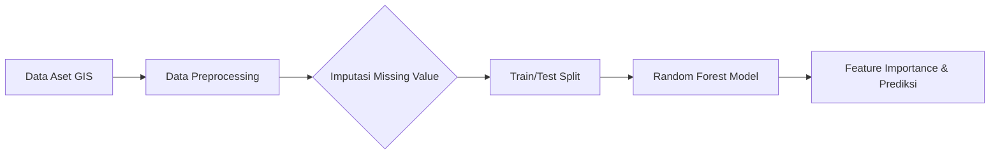

<div align="center">

<h1>🌳 Smart City Tree Risk Prediction</h1>

<h3>Sistem Informasi Geografis (GIS) & Prediksi Risiko Aset Kota</h3>

*Dari data pemeliharaan historis ➔ prediksi risiko bahaya ➔ rekomendasi tindakan arborist otomatis.*

<br>

<!-- BAGIAN LOGO / BADGES -->


<br><br>

<!-- MENU NAVIGASI -->
<a href="#-studi-kasus">📖 Studi Kasus</a> • 
<a href="#-piramida-analitik">🔺 Piramida Analitik</a> • 
<a href="#-arsitektur--alur-kerja-crisp-dm">🏗️ Arsitektur</a> • 
<a href="#-cara-menjalankan">🚀 Cara Menjalankan</a> • 
<a href="#-contoh-output">📊 Contoh Output</a>

</div>

<br>

## 📖 Studi Kasus

Proyek ini diinspirasi oleh studi kasus *City Care Property* di Selandia Baru yang dibahas dalam **Informatics Practitioner Lecture Series 2026** (oleh Bapak Widi Primadepa, *GIS Analyst*).

**Konteks Masalah:**
Dalam konsep *Smart City*, pohon dan infrastruktur hijau merupakan aset kota yang sangat bernilai. Namun, pohon yang rawan tumbang dapat membahayakan keselamatan publik. Seringkali, pemeliharaan hanya dilakukan secara reaktif berdasarkan aduan masyarakat (*Snap and Solve*) tanpa tindakan pencegahan yang terukur, diperparah dengan data antar dinas (seperti rekam jejak perawatan) yang seringkali tidak sinkron.

**Tujuan Solusi:**
Membangun model **Machine Learning Berbasis Data Spasial** untuk memprediksi tingkat risiko (bahaya/aman) dari setiap aset pohon. Hasil prediksi ini memungkinkan *City Council* dan tim lapangan (*arborist*) untuk mengalokasikan anggaran serta memprioritaskan jadwal pemangkasan secara proaktif.

## 🔺 Piramida Analitik

Proyek ini menerapkan tahapan analisis *end-to-end* untuk tata kelola aset kota:

1. **Deskriptif (Apa yang terjadi?):** Data inventaris kota menunjukkan banyak pohon tua dan data riwayat pemangkasan yang tidak lengkap/kosong.
2. **Diagnostik (Mengapa terjadi?):** Analisis spasial dan laporan warga (`Citizen_Reports_Count`) mengindikasikan korelasi antara lamanya waktu tanpa perawatan dengan potensi bahaya pohon.
3. **Prediktif (Apa yang akan terjadi?):** Model `RandomForestClassifier` memprediksi probabilitas pohon mana yang masuk dalam kategori Risiko Tinggi (1) untuk tumbang/membahayakan.
4. **Preskriptif (Apa yang harus dilakukan?):** Sistem merekomendasikan prioritas penugasan (*dispatch*) tim pemeliharaan ke lokasi koordinat (`Latitude`, `Longitude`) aset yang diprediksi berbahaya, mengungguli metode tebang pilih konvensional.

## 🏗️ Arsitektur & Alur Kerja (CRISP-DM)

Sistem ini dirancang untuk menangani masalah data kotor (*missing values*) akibat kurangnya integrasi lintas departemen pemerintah, yang diselesaikan menggunakan teknik *Imputasi Median* sebelum proses pemodelan.



- **Dataset:** Dummy data 1.000 aset pohon (Koordinat, Estimasi Usia, Riwayat Perawatan, Aduan Warga, Indeks Erosi).
- **Algoritma:** Random Forest Classifier.
- **Evaluasi:** Accuracy, Classification Report, dan analisis Feature Importance.

## 🚀 Cara Menjalankan

Ikuti langkah-langkah berikut untuk menjalankan *script* prediksi di komputer lokal Anda:

**1. Clone Repositori**
```bash
git clone https://github.com/Muhammadripalrbb/City-Care-Property.git
cd City-Care-Property
```

**2. Instalasi Library**
Pastikan Python sudah terinstal di sistem Anda. Buka terminal dan jalankan:
```bash
pip install pandas numpy scikit-learn
```

**3. Eksekusi Model**
Jalankan script utama prediksi:
```bash
python City_Care_Property.py
```

## 📊 Contoh Output

Terminal akan mencetak metrik performa model dan tingkat signifikansi dari setiap fitur penyebab risiko:

```text
Accuracy: 0.9250

Classification Report:
               precision    recall  f1-score   support

           0       0.88      0.95      0.92        85
           1       0.96      0.90      0.93       115

    accuracy                           0.93       200
   macro avg       0.92      0.93      0.92       200
weighted avg       0.93      0.93      0.93       200

Feature Importances:
- Tree_Age_Years: 0.1841
- Last_Pruned_Months: 0.4428
- Citizen_Reports_Count: 0.1827
- Soil_Erosion_Index: 0.1904
```
